 

I'm an IT Administrator and web developer based in **Chattogram, Bangladesh**. At **Shajinaz Hospital Ltd.** I look after IT infrastructure, networking, CCTV and the hospital's web presence. Alongside that, I design and build responsive, fast and secure websites with HTML, CSS, Bootstrap, JavaScript, PHP, MySQL and WordPress.

I care about reliable systems, maintainable code and interfaces that are easy to use.

 

 

 

 

 

### Live Client Projects

<table>
<tr>
<td width="33%" valign="top" align="center">

 <b>Shajinaz Hospital Ltd.</b> 
Healthcare portal, doctor appointment system and hospital administration platform. 
<a href="https://shajinazhospital.com/">Live Site</a>
</td>
<td width="33%" valign="top" align="center">

 <b>Fatema Maternity</b> 
Maternity services platform with online appointment booking. 
<a href="https://fatemamaternity.com/">Live Site</a>
</td>
<td width="33%" valign="top" align="center">

 <b>Snus BD</b> 
WooCommerce store with fast checkout and payment integrations. 
<a href="https://snusbd.com/">Live Site</a>
</td>
</tr>
<tr>
<td width="33%" valign="top" align="center">

 <b>Nithy BD</b> 
Corporate agency website built for branding and client conversion. 
<a href="http://nithybd.com/">Live Site</a>
</td>
<td width="33%" valign="top" align="center">

 <b>JRC KSA</b> 
International corporate and industrial portal for Saudi Arabia operations. 
<a href="https://www.jrc-ksa.com/">Live Site</a>
</td>
<td width="33%" valign="middle" align="center">
<a href="https://raselkantirony-coder.github.io/my-portfolio/#works"><b>View all client work →</b></a>
</td>
</tr>
</table>

### Open-Source Projects

<table>
<tr>
<td width="33%" valign="top" align="center">

 <b>AgriHub</b> 
Organic farming and agri-tech website. 
<a href="https://raselkantirony-coder.github.io/AgriHub/">Live Demo</a> · <a href="https://github.com/raselkantirony-coder/AgriHub">Source</a>
</td>
<td width="33%" valign="top" align="center">

 <b>Construction &amp; Manpower</b> 
Engineering and workforce company portal. 
<a href="https://raselkantirony-coder.github.io/Construction/">Live Demo</a> · <a href="https://github.com/raselkantirony-coder/Construction">Source</a>
</td>
<td width="33%" valign="top" align="center">

 <b>TreePlant</b> 
Gardening and plant nursery website. 
<a href="https://raselkantirony-coder.github.io/TreePlant/">Live Demo</a> · <a href="https://github.com/raselkantirony-coder/TreePlant">Source</a>
</td>
</tr>
<tr>
<td width="33%" valign="top" align="center">

 <b>ConsultantDemo</b> 
Technology and fintech consultancy site. 
<a href="https://raselkantirony-coder.github.io/ConsultantDemo/">Live Demo</a> · <a href="https://github.com/raselkantirony-coder/ConsultantDemo">Source</a>
</td>
<td width="33%" valign="top" align="center">

 <b>NGO Website</b> 
Non-profit and donation website. 
<a href="https://raselkantirony-coder.github.io/ngo-website/">Live Demo</a> · <a href="https://github.com/raselkantirony-coder/ngo-website">Source</a>
</td>
<td width="33%" valign="middle" align="center">
<a href="https://github.com/raselkantirony-coder?tab=repositories"><b>Browse all repositories →</b></a>
</td>
</tr>
</table>

 

 

 

 

Chattogram, Bangladesh &nbsp;·&nbsp; IT Administrator · Web Developer · WordPress Developer

